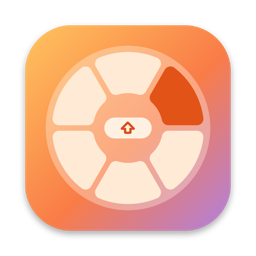
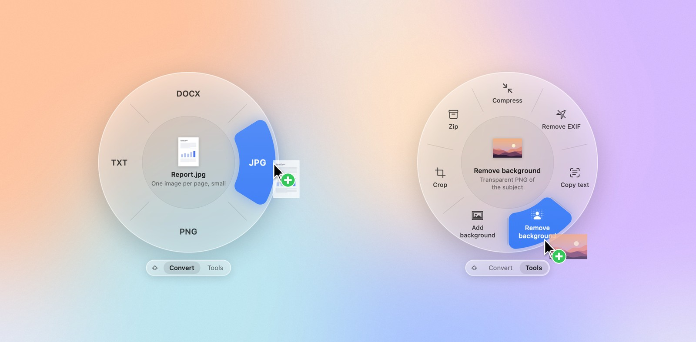
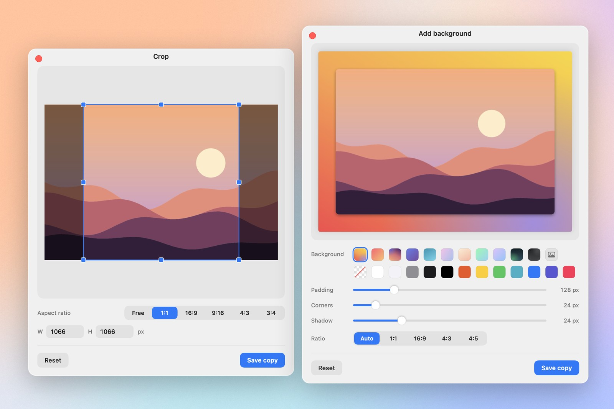

<p align="center">
  
</p>

<h1 align="center">ShiftDrop</h1>

<p align="center">
  Convert, compress and edit files in the middle of a drag.<br>
  Pick up a file, tap <kbd>⇧ Shift</kbd>, drop it on what you need.
</p>

<p align="center">
  
  
  <a href="LICENSE"></a>
</p>

<picture>
  <source media="(prefers-color-scheme: dark)" srcset="docs/hero-dark.jpg">
  
</picture>

## How it works

1. Start dragging one or more files, in Finder or on the Desktop.
2. Tap <kbd>⇧ Shift</kbd>. A glass dial opens around the cursor with everything the file can become.
3. Tap <kbd>⇧ Shift</kbd> again to switch between **Convert** and **Tools**.
4. Hover an item. The middle of the dial shows the file you'll get. Drop to make it.

The result is saved next to the original, for example `Report.pdf` → `Report.jpg`. ShiftDrop never overwrites a file, and nothing leaves your Mac.

To cancel, drop in the middle of the dial or anywhere outside it.

## What's on the dial

| You drag | Convert to | Tools |
| --- | --- | --- |
| **Images**<br>PNG, JPG, HEIC, WebP, AVIF, TIFF, GIF, BMP | PNG, JPG, WebP¹, HEIC, AVIF, PDF, TIFF, GIF, BMP, TXT (text recognized in the image) | Compress, Remove EXIF, Copy text, Remove background, Add background, Crop, Zip |
| **Several images** | the formats all of them can become | Compress, Remove EXIF, Remove background, Make PDF, Zip |
| **PDF** | DOCX, JPG, PNG, TXT | Compress, Copy text, Split pages, Merge², Zip |
| **Documents**<br>DOCX, DOC, RTF, ODT, HTML, TXT, Markdown | PDF, DOCX, RTF, TXT, HTML, ODT | Copy text, Zip |
| **Video**<br>MP4, MOV, M4V | MP4, MOV, M4A (audio only), GIF | Compress, Mute, Zip |
| **Audio**<br>M4A, MP3, WAV, AIFF, CAF | M4A, WAV, AIFF, CAF | Zip |
| **Anything else, folders** | | Zip |

¹ WebP output uses `cwebp` from Homebrew (`brew install webp`). The WebP item is hidden when it isn't installed.<br>
² When you drag several PDFs.

A few details:

- A multi-page PDF converted to images becomes a folder with one image per page.
- **Copy text** puts the text of an image, PDF or document on the clipboard. Text in images is read with on-device recognition.
- **Compress** re-encodes images and PDFs, and turns videos into HEVC at up to 1080p. If the result isn't smaller, you get a message instead of a bigger file.
- **Remove background** lifts the subject out of a photo and saves it as a transparent PNG.

## Editors

**Crop** and **Add background** open a small window. Crop has fixed ratios and exact pixel sizes. Add background puts a screenshot or photo on a gradient, color or image, with padding, rounded corners and a shadow, ready to post. Both save a copy.

<picture>
  <source media="(prefers-color-scheme: dark)" srcset="docs/editors-dark.jpg">
  
</picture>

## Built for the Mac

- **On your Mac.** Everything runs on frameworks that ship with macOS: ImageIO, PDFKit, Vision and AVFoundation. No uploads, no accounts.
- **No special permissions.** ShiftDrop doesn't ask for Accessibility, Input Monitoring or Screen Recording. It notices a drag from mouse clicks and only looks at the dragged files and the Shift key while the mouse button is down. The first time it saves into Desktop, Documents or Downloads, macOS asks once for access to that folder.
- **Looks like it belongs.** Liquid Glass on macOS 26 (a blur material on 14 and 15), your accent color, light and dark mode. On a Force Touch trackpad you feel a light tick as you move between items. Reduce Motion is respected.
- **Stays out of the way.** It lives in the menu bar, where you can turn it off or have it launch at login.

## Install

There is no signed download yet, so build it from source. It takes about a minute.

```bash
git clone https://github.com/dcatmakas/ShiftDrop.git
cd ShiftDrop
./build.sh
open ShiftDrop.app
```

You need macOS 14 or later and Xcode 15 or later (or a Swift 5.9+ toolchain). Move `ShiftDrop.app` to `/Applications` and choose **Launch at Login** from its menu bar icon.

`build.sh` signs the app with your first "Apple Development" certificate if you have one, so macOS remembers folder access between builds. Without one it signs ad hoc. Pick a certificate with `SIGN_IDENTITY="…" ./build.sh`.

## Development

```bash
swift build          # debug build
swift test           # conversion and editor tests
SHIFTDROP_SAMPLE_VIDEO=~/Movies/clip.mp4 swift test --filter MediaSmokeTests   # video and audio, with a real file
```

Debug builds can show the UI without a real drag, which helps when working on the design:

```bash
.build/debug/ShiftDrop --demo-ring ~/Desktop/photo.png            # Convert page
.build/debug/ShiftDrop --demo-ring ~/Desktop/photo.png tools 2    # Tools page, third item hovered
.build/debug/ShiftDrop --demo-editor crop ~/Desktop/photo.png     # an editor window
SHIFTDROP_SNAPSHOT=/tmp/ring.png .build/debug/ShiftDrop --demo-ring ~/Desktop/photo.png   # save a PNG and quit
```

`Scripts/readme/make.sh` regenerates the images in this README from the real UI. It needs Python 3 with Pillow and NumPy.

```
Sources/ShiftDropCore/     conversions and tools, no UI (unit tested)
Sources/ShiftDrop/
  Ring/                    drag detection, the dial panel and view
  Editors/                 Crop and Add background windows
  Support/                 running actions, the result bubble
Scripts/                   app icon and README image generators
```

To add a format or tool: declare it in `Format` or `Tool`, offer it in `ActionCatalog` (up to eight items, clockwise from 12 o'clock), implement it in the matching converter, route it in `ActionRunner`, and add a test. [`CLAUDE.md`](CLAUDE.md) has more notes on how the pieces fit.

## Roadmap

- Annotate and redact tools
- Settings for the trigger key, output folder and compression quality
- Text recognition for scanned PDFs
- A signed, notarized download

Ideas and pull requests are welcome.

## License

[MIT](LICENSE) © 2026 Doğukan Çatmakaş
